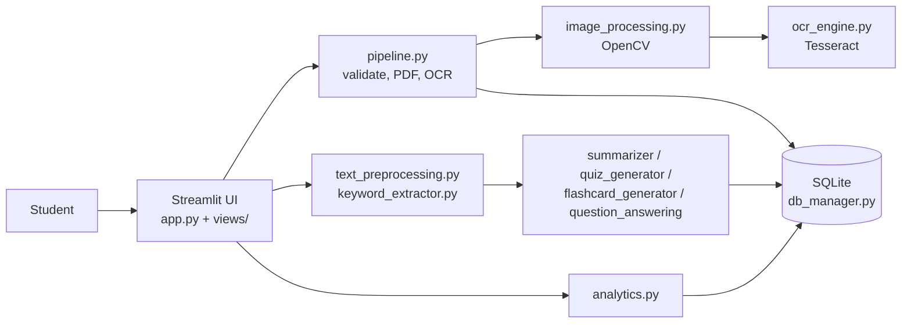
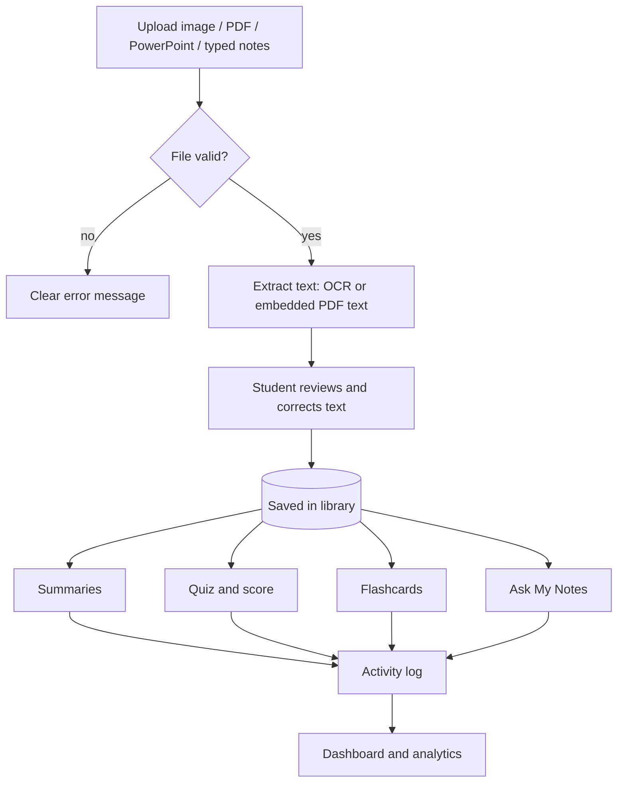
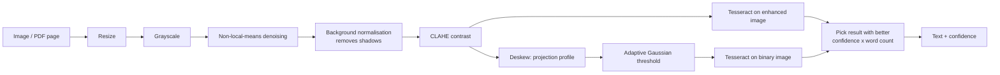
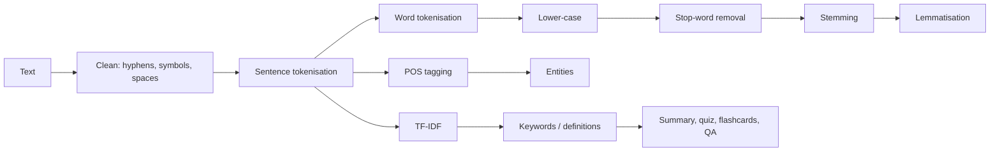
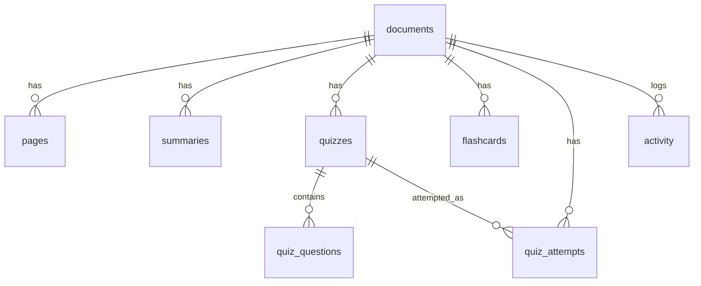

# NoteVision AI
**An Intelligent Notes Analyzer and Personalized Learning Assistant** — BCA (AI & ML) major project

## 1. Abstract
Students keep notes on paper or in scanned PDFs, which cannot be searched, summarised or tested on. NoteVision AI reads handwritten or printed notes with **Computer Vision (OpenCV + Tesseract OCR)**, cleans them with an **NLP pipeline (NLTK, TF-IDF)** and turns them into summaries, multiple-choice quizzes, flashcards and a question-answering assistant. Everything runs locally on a student laptop, and all generated material is built only from sentences and terms that exist in the student's own notes.

## 2. Problem statement
Revision from raw notes is slow: there is no search, no self-testing, and no way to see progress. Existing tools either need typed notes, send documents to a cloud service, or generate generic content that is not grounded in the student's material.

## 3. Objectives
1. Convert images / PDFs of notes into editable text (OCR).
2. Clean and analyse the text with a real NLP pipeline.
3. Generate quick, detailed and exam-oriented summaries.
4. Generate note-grounded MCQs, flashcards and answers to questions.
5. Persist documents and track study activity honestly (no fake data).

## 4. Proposed system and features
Only the features students actually use were kept, each designed so it can grow later:

| Page | What it does |
|---|---|
| Dashboard | Real stats, recent documents/activity, 14-day progress chart, quick actions |
| Upload Notes | JPG/PNG/PDF/PPTX upload, preview, title/subject, progress; or type/paste notes; labelled demo notes |
| My Library | Search + subject filter, document cards, open / summary / quiz / flashcards / delete (2-step) |
| Notes Analyzer | Original vs processed image, OCR confidence, **editable text**, NLP view (tokens, stems, lemmas, keywords, POS, entities) |
| Smart Summarizer | Quick, Detailed, Exam Revision Notes; TXT download |
| Quiz Generator | 5/10/15 MCQs, scoring, review, retake, new quiz, weak topics |
| Flashcards | Flip, next/previous, shuffle, known / need revision, saved progress |
| Ask My Notes | TF-IDF retrieval chat with source document + page, refuses when the answer is not in the notes |
| Study Analytics | Quiz trend, subject activity, flashcard progress, insights |

**Advantages over the existing approach:** works offline, no document upload to external services, answers always traceable to the notes, honest about OCR limits.

## 5. Technology stack
Python 3.10+, python-pptx (PowerPoint reading), Streamlit (UI and built-in charts), SQLite, OpenCV, Tesseract (pytesseract), PyMuPDF (PDF reading), NLTK, scikit-learn. Nothing outside the Applied AI syllabus is needed.

## 6. System architecture


## 7. Application workflow


## 8. Computer Vision implementation (`modules/image_processing.py`, `ocr_engine.py`)

* Confidence below 60% marks a document **Needs review** and shows a warning. **Handwriting is not guaranteed**: Tesseract is built for print, so handwritten text must be checked and corrected in the Notes Analyzer. Nothing is invented for unreadable text.

## 9. NLP implementation


### Where each syllabus technique is used
| Technique | Implementation | Used in |
|---|---|---|
| Image acquisition | `cv2.imdecode`, PyMuPDF page rendering | `pipeline.py` |
| Grayscale, noise reduction, thresholding, enhancement | `image_processing.preprocess` (denoise, CLAHE, adaptive threshold, deskew) | Upload, Analyzer image preview |
| OCR | `ocr_engine.ocr_image` (Tesseract + confidence) | Upload |
| Tokenisation | NLTK `sent_tokenize`, regex word tokens | `text_preprocessing.py` |
| Stop-word removal | scikit-learn list + domain additions | Analyzer, keywords |
| Stemming / Lemmatisation | Porter stemmer / WordNet lemmatiser | Analyzer, retrieval (`analyzer_stems`) |
| POS tagging / NER | NLTK tagger; rule-based NER (capitalised words and acronyms) | Analyzer |
| Bag of Words / TF-IDF | `TfidfVectorizer` | Keywords, summariser, QA |
| Text similarity | cosine similarity | Summary redundancy removal, QA retrieval |
| Summarisation | extractive: TF-IDF sentence score + keyword/definition/position bonus + MMR-style redundancy filter | Summarizer |
| Question answering | TF-IDF passage retrieval + sentence ranking + coverage check | Ask My Notes |
| Question generation | definitions (`X is ...`) and cloze blanks; distractors from other note terms (WordNet noun filter) | Quiz, Flashcards |

## 10. Database design

Foreign keys use `ON DELETE CASCADE`, so deleting a document removes everything generated from it. Schema: `database/schema.sql`.

## 11. Installation
1. Install **Python 3.10+** and **Tesseract OCR**
   * Windows: installer from the UB-Mannheim Tesseract build (default path is auto-detected, or set `TESSERACT_CMD`)
   * Ubuntu/Debian: `sudo apt install tesseract-ocr` · macOS: `brew install tesseract`
2. In the project folder:
```bash
python -m venv .venv
.venv\Scripts\activate          # Windows   (Linux/macOS: source .venv/bin/activate)
pip install -r requirements.txt
```

NLTK data (punkt, wordnet, tagger) downloads automatically on first run; the app also works with built-in fallbacks if you are offline.

## 12. Running
```bash
streamlit run app.py
```
Open the Upload page and use **Load demo notes** to try every feature immediately (clearly labelled `[Demo]`; delete it any time).

## 13. Testing
```bash
python -m unittest discover -s tests -t .
```
Automated tests cover OCR on clean/rotated images, deskew, NLP pipeline, keyword and definition extraction, summaries (grounding), retrieval and refusal, quiz structure (4 unique options, answer taken from the notes), flashcards, upload pipeline (image, digital PDF, scanned PDF, invalid/empty/corrupt files), database CRUD, cascade delete and **persistence across restart**.
The full click-through (upload → summary → quiz → submit → flashcards → ask → analytics) was also run with Streamlit's `AppTest` harness and in a real browser.
No accuracy figures are claimed: OCR/quiz quality depends on your notes. To evaluate for your viva, compare OCR output with the ground-truth text of a few of your own pages (character error rate) and review quiz questions manually.

## 14. Project structure
```
app.py  config.py  requirements.txt
modules/    image_processing, ocr_engine, pipeline, text_preprocessing, keyword_extractor,
            summarizer, quiz_generator, flashcard_generator, question_answering, analytics, exporter, ui
views/      dashboard, upload, library, analyzer, summarizer_page, quiz, flashcards, ask_notes, analytics_page
database/   db_manager.py, schema.sql
assets/     styles.css, demo_notes.txt          tests/   unittest suite
uploads/    original files (unique safe names)  generated/  processed page images   data/  notevision.db
```
(`views/` is used instead of `pages/` because Streamlit auto-creates its own menu from a `pages/` folder.)

## 15. Security and file handling
Extension and size validation (20 MB, 30 PDF pages), corrupted/encrypted PDF detection, sanitised unique filenames, files saved only after OCR succeeds, deletion needs a confirmation click, nothing is sent to external services.

## 16. Limitations
* Handwriting recognition is limited (Tesseract); correct the text manually when confidence is low.
* Summaries, quizzes and answers are **extractive**: they reuse your sentences rather than rewriting them, so very short or badly structured notes give fewer or weaker questions.
* The "answer" in Ask My Notes lists the most relevant sentences; it does not paraphrase or reason across documents.
* English only. Poor OCR output leads to poor downstream material, so review the text first.

## 17. Future enhancements
Handwriting model (TrOCR) as an optional plug-in, abstractive summaries with a small transformer, spaced-repetition scheduling for flashcards, multi-language OCR, user accounts, export to Anki, mobile camera capture.

## 18. Conclusion
NoteVision AI shows Computer Vision and NLP working together in one practical product: scanned notes become searchable text, and that text becomes revision material that is traceable to the student's own words.
